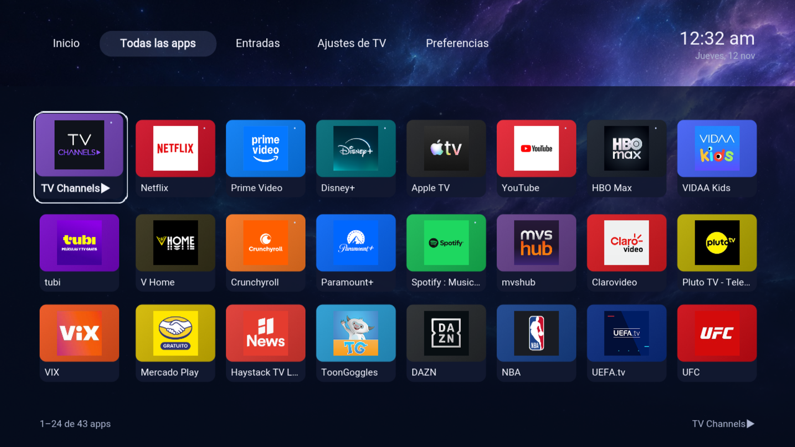

# VIDAA Nebula — Hisense HU40 root, SSH y HOME

**Root y personalización de VIDAA en Hisense HU40E5600FFWV · firmware V0000.09.09K.P1218 · MTK9602 ARMv7.**

Proyecto basado en [Alvidaa, de carteakey](https://github.com/carteakey/alvidaa).
La adaptación experimental **TubeFree para VIDAA** usa como base
[TizenTube, de reisxd](https://github.com/reisxd/TizenTube).
El HOME nativo también deriva de [Free My TV](https://github.com/felipericardo/tv-launcher).
Créditos, revisiones y licencias: [CREDITS.md](CREDITS.md).

VIDAA Nebula reúne el procedimiento documentado de acceso root, las herramientas
editables y el HOME que instalamos en una TV propia. Incluye lo que funcionó,
los intentos que fallaron y los límites de la evidencia. No es un instalador
universal para todos los televisores Hisense ni para cualquier firmware VIDAA.



## Estado al 12 de noviembre de 2026

| Área | Estado |
| --- | --- |
| Root / SSH | Confirmado en vivo: uid/gid 0, Dropbear en TCP 8008 |
| HOME nativo | Instalado: galaxia animada, favoritas, grid animado, menú por OK largo y colores por app |
| Volumen HDMI ARC | HUD muestra el valor CEC válido entre 0 y 100; no cuenta pulsaciones |
| Reversión del HOME | Respaldos, hashes, metadatos y restauración guardados en la TV |
| YouTube original | El propietario confirmó reproducción superior a 90 s y continuada |
| **TubeFree / YouTube sin anuncios** | **Inconcluso. No se demostró reproducción estable sin anuncios en VIDAA** |
| Arranque en frío / persistencia completa | Pendiente de una nueva prueba documentada; no se infiere de SSH activo |

## Modelo y compatibilidad

| Dato observado | Valor |
| --- | --- |
| Modelo reportado por el runtime | `HU40E5600FFWV` |
| Firmware exacto | `V0000.09.09K.P1218` |
| Plataforma | `MTK9602`, `armv7l`, kernel `4.19.79+` |
| Versión anunciada | VIDAA 9.0 |
| Navegador de TubeFree | Odin / Chromium 111 |
| Motor de YouTube original | Cobalt Evergreen, identificado como 25 LTS en la prueba |
| Red local | SSH 8008, MQTT 36669, CDP observado en 9226 |

`HU40E5600F` y `40H5G` aparecen como nombres históricos en algunos scripts:
no prueban compatibilidad con todos los equipos vendidos con esos nombres.
**HE40E5600FFWTS / N0410, 55A7KAU / P1015, U7Q y U8Q son referencias distintas.**
No copiar su receta de USB, direcciones, arquitectura o hashes sobre esta TV.

## Documentación

1. [Root y SSH: preparación, cadena y comprobaciones](docs/ROOT-HU40.md).
2. [Dificultades, correcciones y límites](docs/FINDINGS.md).
3. [HOME: construcción local, despliegue y recuperación](docs/HOME.md).
4. [TubeFree: estado pendiente y cómo continuar](docs/TUBEFREE.md).
5. [Auditoría cronológica de TubeFree, saneada](docs/TUBEFREE-AUDIT-2026-11-11.md).
6. [Registro detallado de la implementación visual](docs/HOME-IMPLEMENTATION.md).
7. [Proveniencia y alcance de esta publicación](docs/PUBLICATION.md).

## Código y pruebas locales

Requisitos para las pruebas: Node.js 20 o superior y Python 3.11 o superior.
No hace falta conectarse a una TV para ejecutarlas.

```sh
git clone https://github.com/Chrisaxcg/vidaa-nebula-root-hu40.git
cd vidaa-nebula-root-hu40
node --test tools/launcher-host/*.test.cjs tools/tubefree/*.test.cjs
python3 scripts/check-public.py
```

El código de firmware, los binarios de Hisense, las claves SSH, los tokens,
las capturas de tráfico y los paquetes de instalación con claves personales
**no se distribuyen**. Los bundles finales se construyen con los originales
extraídos de tu propio televisor y se mantienen privados.

## Investigación pendiente

- [ ] Repetir una prueba en frío de SSH, HOME, preferencias y reglas de red.
- [ ] Documentar una reproducción base prolongada en Odin sin modificaciones.
- [ ] Resolver la pérdida de flujo de vídeo en Odin antes de activar adblock.
- [ ] Entender el arranque APM de Cobalt y su error de red con página local.
- [ ] Validar cambio de vídeo, búsqueda, reanudación y transición anuncio/contenido.
- [ ] Confirmar HDMI ARC después de desconexión física y reconexión.

Uso únicamente en tu propio equipo o con autorización. Conserva un acceso SSH
y una copia original antes de cambiar el HOME. No se flashea firmware, no se
escribe `/OAD`, no se modifica verified boot y no se trabaja en eludir DRM.

**English discovery summary:** Hisense VIDAA TV root and SSH research for
HU40E5600FFWV, firmware V0000.09.09K.P1218, MTK9602 ARMv7. Native custom launcher
with animated galaxy background and HDMI CEC volume UI. Based on Alvidaa;
unfinished TubeFree VIDAA adaptation based on TizenTube. Tested on one device,
not a universal jailbreak or a working ad-free YouTube release.
